#  디저트 랜드 (Dessert Land)

[](https://github.com/ryushin01/DessertLand/actions/workflows/ci.yml)


디저트 랜드는 **전 세계의 디저트**가 모인 달콤한 나라를 콘셉트로, 디저트를 소개하고 판매하는 글로벌 쇼핑몰입니다. 한국어를 기본으로 **영어, 일본어, 중국어, 프랑스어, 이탈리아어, 스페인어, 독일어, 포르투갈어, 튀르키예어까지 10개 언어**를 지원합니다.

**[데모 바로 보기](https://dessert-land-ryushin01.vercel.app)** · **[어드민 데모](https://dessert-land-ryushin01.vercel.app/admin)** · **[디자인 시스템(Storybook)](https://dessert-land-ryushin01.vercel.app/storybook/index.html)** · 결제는 테스트 카드 `4242 4242 4242 4242`, 미래의 만료일, 아무 CVC로 해 볼 수 있고 실제 청구는 없습니다.

> **프로젝트 상태:** 별도 백엔드 없이 동작하는 **데모 프로젝트**입니다. 상품 정보와 가격은 예시 값이고, 환율은 고정값이며, 결제는 **실제 청구가 없는 테스트 결제**이며 배송도 이루어지지 않습니다. Stripe 테스트 키가 있으면 Stripe 화면에서 카드 정보를 입력하고, 없으면 카드 정보를 받지 않는 내장 테스트 결제창을 씁니다. 운영 키는 코드에서 거부합니다.

## 화면

사진은 [Unsplash](https://unsplash.com), [Wikimedia Commons](https://commons.wikimedia.org)·[Flickr](https://www.flickr.com)(자유 라이선스), 아이콘은 [Flaticon UIcons](https://www.flaticon.com/uicons)에서 가져왔습니다. 출처는 아래 [출처](#출처)에 있습니다.

| 첫 화면 | 카테고리 쇼케이스 |
|---|---|
| 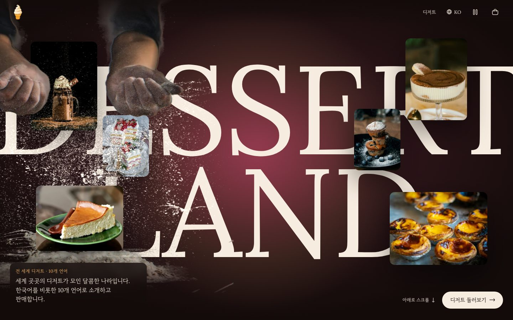 |  |

| 글자 마스크 줌 | 세계 디저트 여행 |
|---|---|
| 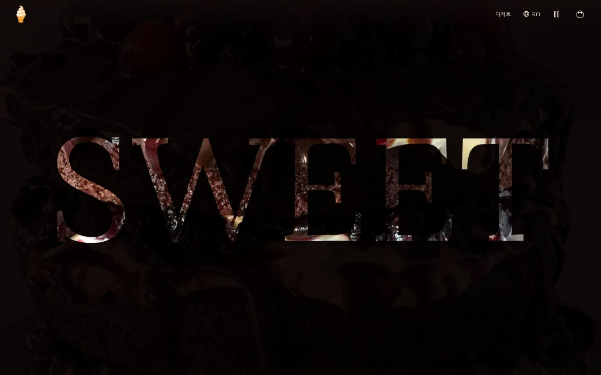 | 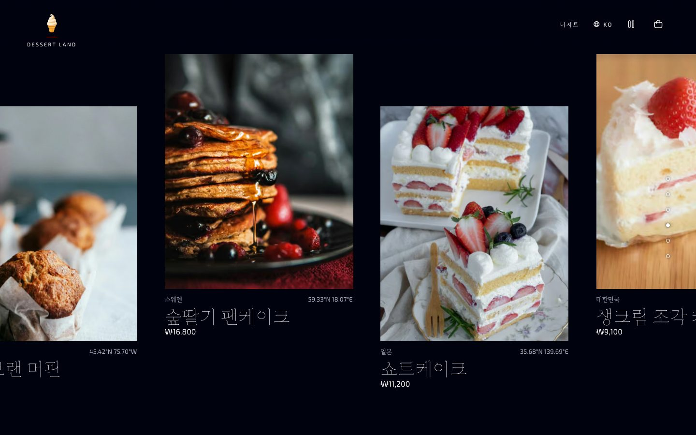 |

| 상품 목록 | 찾기·맛 필터 |
|---|---|
| 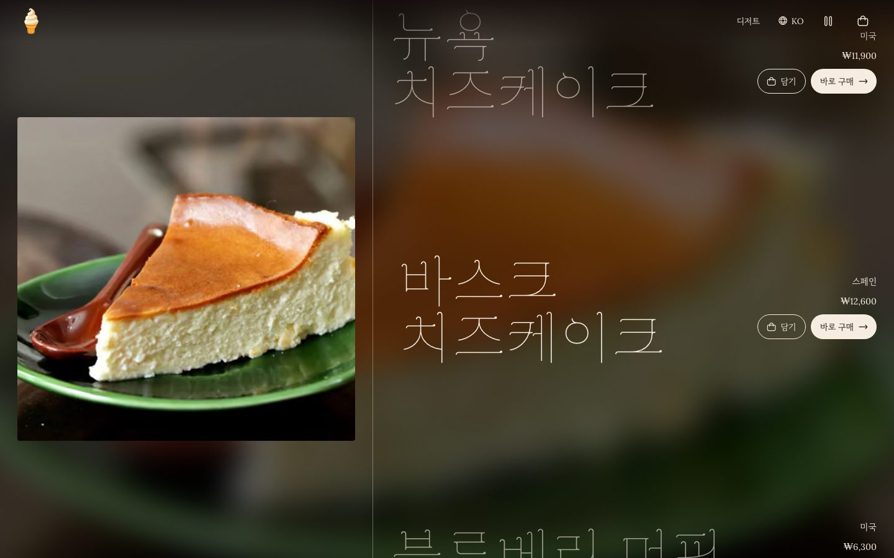 |  |

| 상품 상세(일본어) | 장바구니(일본어) |
|---|---|
| 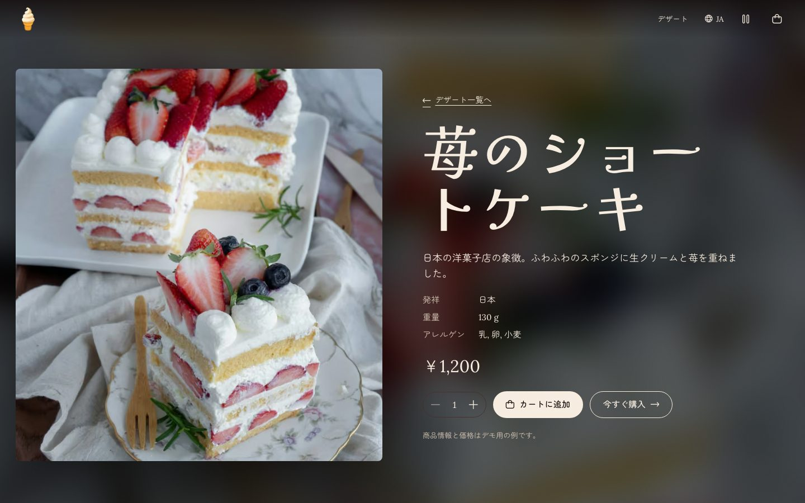 | 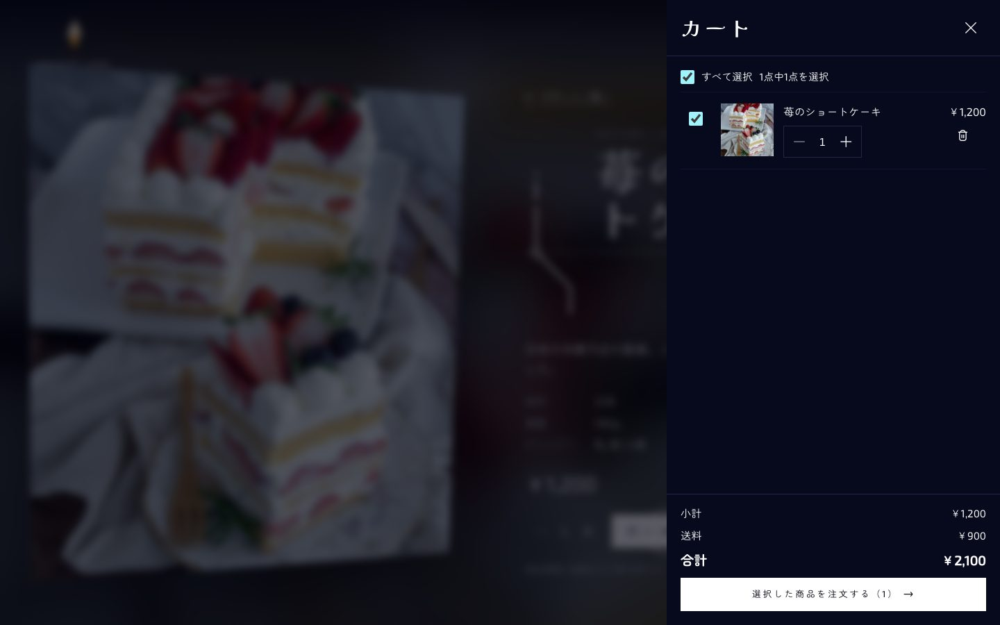 |

| Stripe 테스트 결제 | 주문 완료 |
|---|---|
| 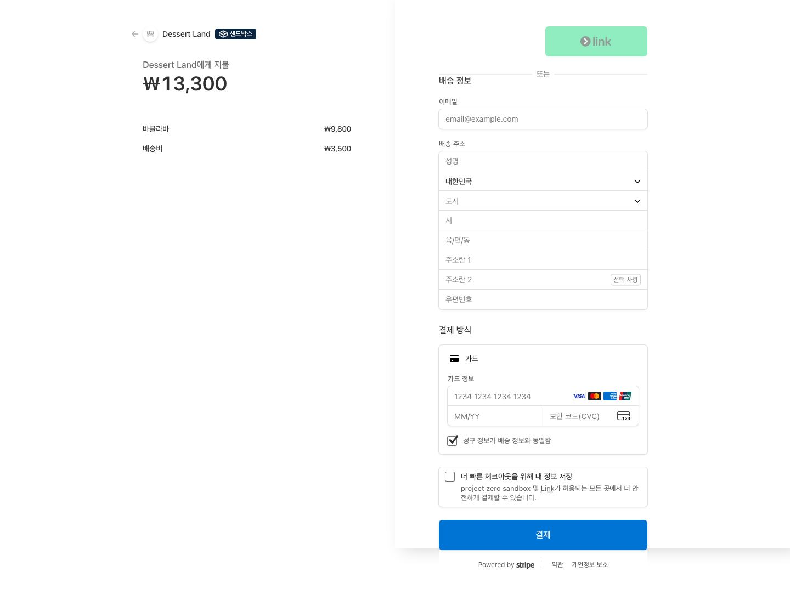 | 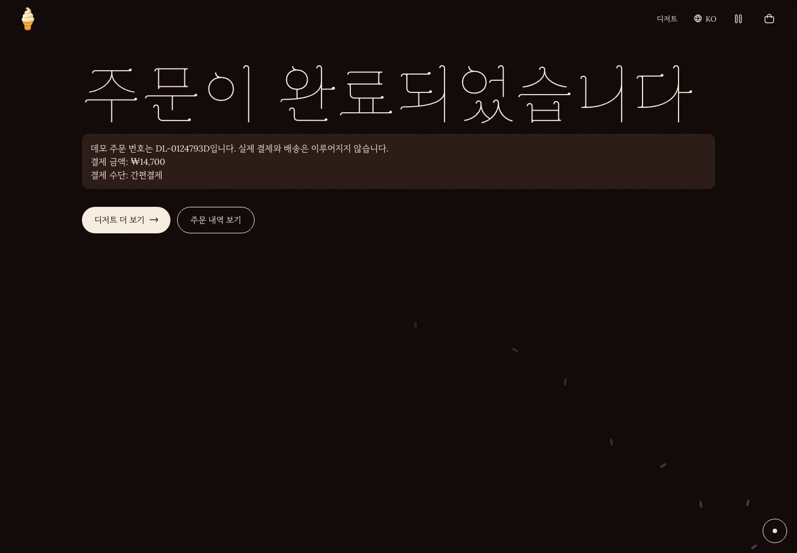 |

| 주문 내역 | 모바일 |
|---|---|
| 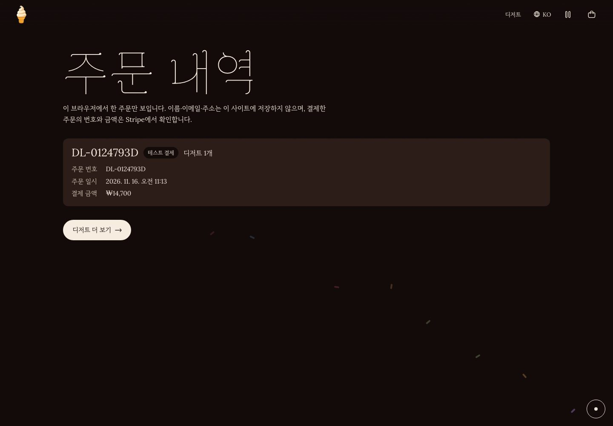 | 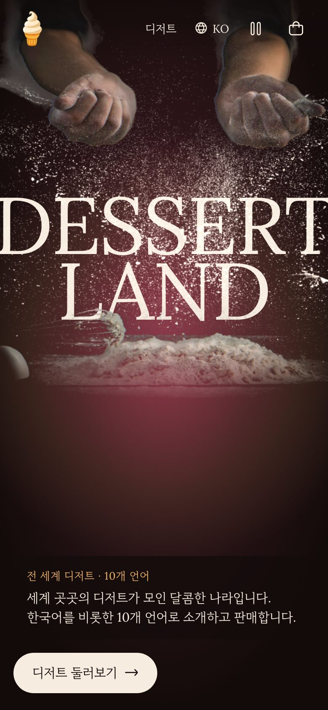 |

## 어드민(관리자 화면)

**[어드민 데모](https://dessert-land-ryushin01.vercel.app/admin)** — 들어가기 화면에서 **"관리자로 둘러보기"**를 누르면 됩니다(공개 데모, 비밀번호 없음).

| 들어가기 | 대시보드 |
|---|---|
| 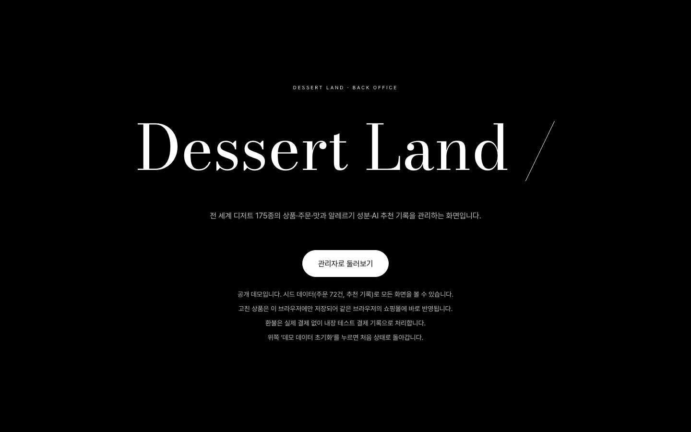 | 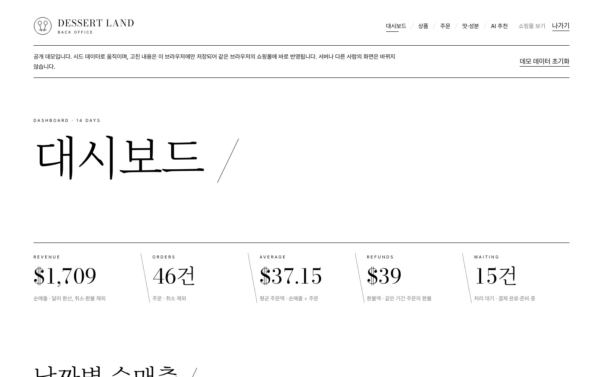 |

| 인기 상품(큰 이름 / 원형 배지) | 상품 목록 |
|---|---|
| 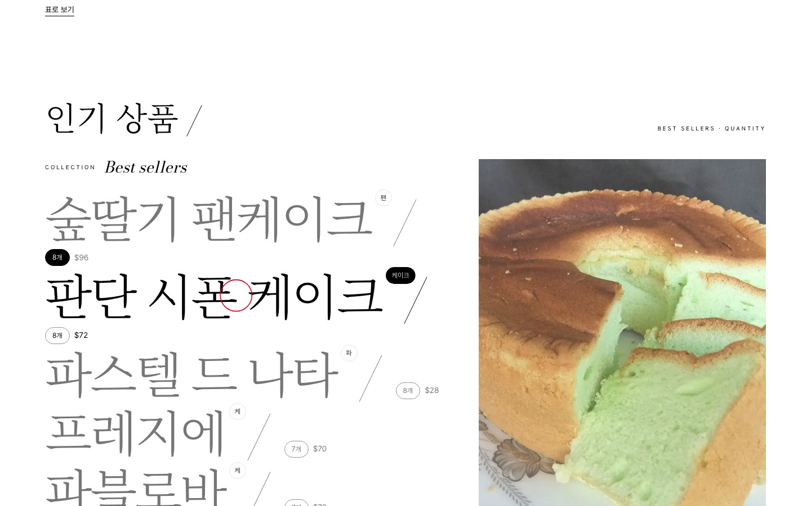 | 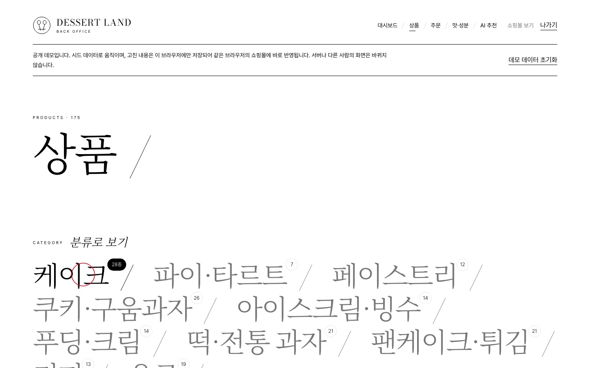 |

| 상품 수정(10개 언어) | 주문 환불 |
|---|---|
| 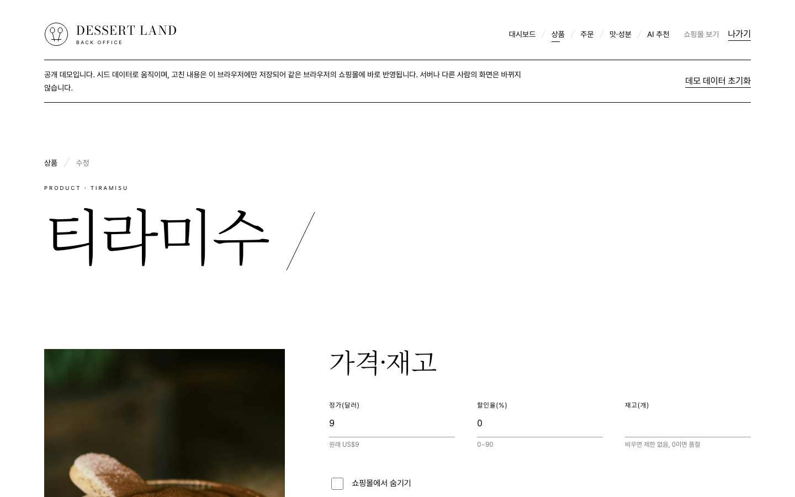 | 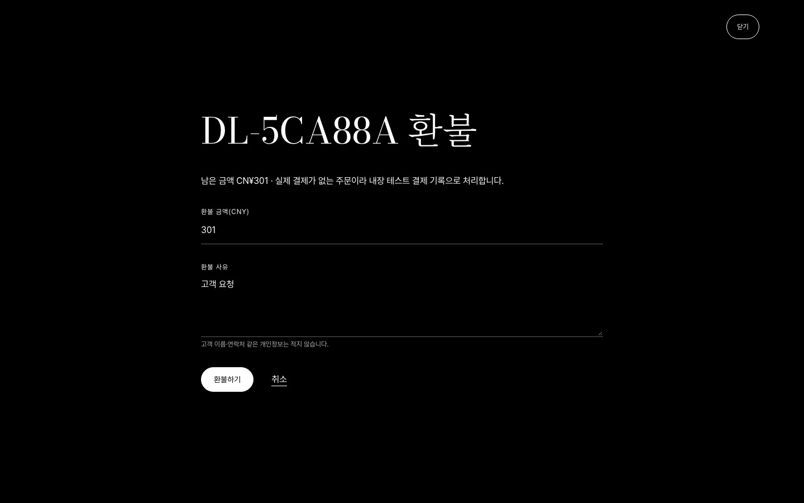 |

**들어가는 방법**

1. https://dessert-land-ryushin01.vercel.app/admin 을 엽니다(들어가기 화면으로 넘어갑니다).
2. **관리자로 둘러보기**를 누르면 대시보드로 갑니다. 화면 위쪽 **데모 데이터 초기화**로 언제든 처음 상태로 돌아갑니다.

**되는 것**

- 대시보드: 지난 14일 순매출·주문·평균 주문액·환불액·처리 대기, 날짜별 순매출(표로 보기), 인기 상품, 분류별 판매
- 상품 175종: 찾기, 분류·나라·상태 거르기, 가격·할인·재고(0이면 품절)·숨김, 10개 언어 이름·설명, 맛·알레르기 성분, 상품 추가
- 주문: 찾기, 상태·결제 방식 거르기, 상세, 단계 바꾸기(결제 완료 → 준비 중 → 배송 중 → 배송 완료, 취소), 환불(부분·전액)
- 맛·성분 표, AI 추천 기록(고른 맛·추천 상품·AI/기본 추천. 고객이 쓴 문장은 남기지 않음)
- **쇼핑몰 반영:** 어드민에서 고친 상품은 **같은 브라우저**의 쇼핑몰(목록·상세·장바구니·결제)에 바로 보입니다. 쇼핑몰에서 한 주문과 받은 추천도 어드민에 나옵니다.
- 인터넷 없이도(로컬 실행) 내용과 글꼴이 그대로 뜹니다.

**안 되는 것(공개 데모)**

- 고친 내용은 서버에 저장되지 않습니다. 다른 브라우저·다른 사람의 쇼핑몰은 바뀌지 않습니다.
- 시드 주문과 환불은 어드민 화면의 MSW(Mock Service Worker)가 응답합니다. 환불은 실제 결제가 없는 내장 테스트 결제 기록으로만 처리합니다(Stripe 환불 API를 부르지 않음).
- 새로 추가한 상품은 어드민에만 보입니다(쇼핑몰의 상품 페이지·결제 가격표는 카탈로그로 미리 만들어 둠).
- 시드 주문·추천 기록은 예시 값이고 고객 개인정보가 없습니다.

데모를 끈 빌드(`NEXT_PUBLIC_DEMO` 없음)에서는 쇼핑몰이 원래대로 동작하고, 어드민은 운영 환경 변수 `ADMIN_PASSWORD`(12자 이상) 비밀번호로만 들어갑니다. 이때 주문은 Stripe 테스트 모드 세션에서 읽고 Stripe 주문 환불은 Stripe 테스트 모드 환불 API로 처리합니다. 디자인은 [marieweber.fr](https://www.marieweber.fr/en/)을 레퍼런스로 했습니다(유료 글꼴·사진은 쓰지 않고 무료 글꼴과 직접 그린 그림으로 대신함, 아래 출처).

## 주요 기능

| 구분 | 내용 |
|---|---|
| 전 세계 디저트 | 35개 나라와 기원이 여럿인 "기타"까지 175종. 케이크, 파이·타르트, 페이스트리, 쿠키·구움과자, 아이스크림·빙수, 푸딩·크림, 떡·전통 과자, 팬케이크·튀김, 커피, 음료의 10개 분류 |
| 10개 언어 | ko(기본), en, ja, zh, fr, it, es, de, pt, tr. 언어별 URL, 통화, 국가 이름, 숫자 표시. 언어 메뉴는 원형 국기와 나라 이름으로 고름 |
| 쇼핑 | 분류별 목록, 이름·나라로 찾기, 맛과 빼고 싶은 알레르기 성분으로 좁히기, 상품 상세, 장바구니(저장 유지) |
| AI 추천 | 입맛을 적으면 Claude가 카탈로그 안에서 디저트를 추천(스트리밍). 키가 없으면 규칙 기반 추천 |
| 구매 | 장바구니에서 고른 상품만 주문(산 상품만 장바구니에서 뺌), 상세와 상품 목록의 바로 구매(장바구니 유지), 배송 정보 입력과 오류 안내, 이 브라우저의 주문 내역 |
| 결제 | Stripe Checkout 테스트 모드(키가 없으면 내장 테스트 결제창), 서버 금액 검증, 중복 결제 방지 |
| 첫 화면 인터랙션 | 마우스 위치에 따라 가운데 손과 밀가루가 움직이고 빛이 바뀌는 WebGL 2.5D 시차 |
| 커서 | 따라오는 링, 흩날리는 스프링클, 끌어당기는 버튼, 지나간 자리에 피어나는 사진 |
| 스크롤 | 원형으로 열리는 장면 전환, 글자 마스크 줌, 가로 스크롤 여행, 단어별 밝아짐, 패럴랙스 |
| 보안 | 콘텐츠 보안 정책(CSP), 프레임 삽입 금지, 서버 금액 검증, 이 사이트가 만든 결제 세션만 확인. 주요 화면의 CSP 위반을 E2E로 검사 |
| 성능 | Web Vitals 수집, 페이지별 전송량 예산(E2E), 언어별 글꼴과 필요한 코드·메시지만 로드, 분류별 정적 상품 목록 |
| 접근성 | 모션 멈춤 버튼, `prefers-reduced-motion` 대응, 키보드 초점 시 장면 이동, 본문 바로가기, 모달·오류 문구 낭독 |
| 검색 엔진 | 언어별 대표 주소와 hreflang, 사이트맵, 상품 구조화 데이터(JSON-LD) |
| 운영 | Sentry 오류 수집(같은 사이트 중계, 서버 오류 포함), 오류 화면, 이미지 변형 수 관리 |
| 어드민 | `/admin`: 대시보드, 상품·주문·맛과 성분·AI 추천 기록 관리, 공개 데모(관리자로 둘러보기)와 실제 인증(비밀번호), 같은 브라우저 쇼핑몰 반영 |

## 기술 스택


| 구분 | 사용 기술 |
|---|---|
| 프레임워크 | Next.js 16 (App Router), React 19, TypeScript |
| 스타일 | Panda CSS(쇼핑몰), CSS Modules(어드민, 쇼핑몰 CSS 예산과 분리) |
| 상태 | jotai |
| HTTP | Wretch(`shared/api`) |
| 검증 | zod(어드민 입력·저장값·API 요청) |
| API 목업 | MSW(Mock Service Worker): Vitest(Node)·Storybook·Playwright 목업 서버·어드민 공개 데모와 오프라인(Service Worker) |
| 다국어 | next-intl, country-flag-icons(언어 메뉴 국기) |
| 결제 | Stripe Checkout(테스트 모드) |
| AI | Claude API (`@anthropic-ai/sdk`) |
| 모션 | GSAP(ScrollTrigger), Lenis, OGL(WebGL) |
| 품질 | ESLint(jsx-a11y), Steiger, Vitest, Testing Library, MSW, Storybook 10, Playwright, axe, size-limit, Lighthouse CI |
| 모니터링 | Sentry(DSN이 있을 때만, 같은 사이트 중계·서버 오류 포함), web-vitals, Vercel Speed Insights |
| 구조 | Feature-Sliced Design |

## 시작하기

Node.js 22(`.nvmrc`)와 pnpm이 필요합니다.

```bash
corepack enable pnpm
pnpm install
pnpm dev    # http://localhost:3000
```

`.env` 없이도 바로 데모로 동작합니다. 결제는 내장 테스트 결제창, 추천은 규칙 기반 기본 추천으로 끝까지 진행됩니다. 프로덕션 확인은 `pnpm build && pnpm start`(http://localhost:3000)입니다. Stripe 테스트 결제와 AI 추천을 쓰려면 `.env.example`을 `.env.local`로 복사해 키를 넣습니다.

**오프라인:** 글꼴·사진·아이콘을 모두 같은 출처에서 제공하므로 인터넷 없이도 모든 화면이 그대로 보입니다(설치만 인터넷 필요). Stripe나 Claude API에 닿지 못하면 결제는 내장 테스트 결제로 바뀌며 화면에 안내(`role="status"`)가 뜨고, 추천은 "기본 추천 (AI 미사용)"으로 보여 줍니다. Sentry·Speed Insights는 실패해도 화면에 영향이 없습니다. `e2e/offline.spec.ts`가 localhost 밖 요청을 모두 막은 상태에서 이를 확인합니다.

| 명령 | 설명 |
|---|---|
| `pnpm build` / `pnpm start` | 프로덕션 빌드와 실행 |
| `pnpm typecheck` / `pnpm lint` / `pnpm lint:fsd` | 타입 검사, 린트, FSD 구조 검사(Steiger) |
| `pnpm test` | 단위 테스트 |
| `pnpm e2e` | 프로덕션 빌드 기준 E2E와 접근성 검사(`pnpm build` 후 실행) |
| `pnpm size` / `pnpm lhci` | 번들 크기 예산 / Lighthouse 점수 기준 검사(`pnpm build` 후 실행) |
| `pnpm analyze` | 번들 분석 화면 |
| `pnpm storybook` | 컴포넌트 문서 |
| `pnpm screenshots` | README 화면 다시 찍기 (Stripe 키 없이 `pnpm build && pnpm start` 뒤 `BASE_URL` 지정) |

## 프로젝트 구조

```
src/
├─ app/[locale]/   # 쇼핑몰 라우트. _pages를 다시 내보냅니다.
├─ app/admin/      # 어드민 라우트(따로 된 루트 레이아웃)
├─ proxy.ts        # 언어 라우팅, 어드민 세션 확인
├─ _app/           # 레이아웃, 상태·모션 설정, 전역 스타일
├─ _pages/         # 홈(히어로·쇼케이스 등 섹션), 목록, 상세, 주문(주문 폼)
├─ widgets/        # 머리글(언어·모션 전환), 바닥글, 장바구니, 커서, 부드러운 스크롤
├─ features/       # 담기, 바로 구매, 장바구니 요약, 결제, AI 추천
├─ entities/       # 상품 카탈로그, 장바구니(합계 포함)
└─ shared/         # 다국어, 모션, UI
```

## 문서

| 문서 | 내용 |
|---|---|
| [개발 가이드](docs/development.md) | 언어와 상품 추가, 모션 규칙, 사진과 아이콘 라이선스 |
| [시퀀스 다이어그램](docs/sequence-diagrams.md) | Stripe 테스트 결제, 내장 테스트 결제, AI 디저트 추천(스트리밍) |
| [변경 기록](CHANGELOG.md) | 버전별 변경 사항 |
| [사진 출처](docs/credits.md) | 상품·첫 화면 사진 176장의 저작자, 사용 허락(라이선스), 원본 |

## 웹 폰트

| 글꼴 | 쓰는 곳 | 굵기 |
|---|---|---|
| Exo 2 | 영문·숫자 (제목·본문) | 200~500 가변 |
| 그란디플로라 원 | 한국어 제목 | 400 |
| 하다 바탕 | 한국어 본문 | 400·700 |
| Kaisei Decol · Zen Maru Gothic | 일본어 제목 · 본문 | 500 · 400·500·700 |
| Noto Serif SC · Noto Sans SC | 중국어 제목 · 본문 | 500 · 400·500·700 |
| Bodoni Moda · Noto Serif KR · Pretendard | 어드민 영문 제목 · 한글 제목 · 본문 | 400 가변 · 300 · 가변 |

저작자·라이선스·원본은 아래 출처 표에 있습니다. 하다 바탕은 저장소에서 직접 제공하며, 화면에 쓰는 글자만 담은 작은 파일을 먼저 받고 나머지 글자는 글자 묶음별 조각으로 나눠 그 글자를 쓸 때만 받습니다(`pnpm fonts`로 다시 만듦). Exo 2와 한중일 글꼴은 Fontsource 패키지에서 가져와 같은 출처로 제공하며(한중일 글꼴은 `pnpm install` 때 `public/fonts/cjk/`로 복사), 그 언어 화면에서만 받습니다. 외부 글꼴 서버(Google Fonts)는 쓰지 않습니다.

## 출처

| 자료 | 저작자 | 사용 허락 | 원본 |
|---|---|---|---|
| 상품·첫 화면 사진 17장 | Unsplash 사진가 ([목록](docs/credits.md#unsplash)) | Unsplash License | [unsplash.com](https://unsplash.com) |
| 상품 사진 158장 (1400px 이하로 줄여 WebP로 바꿈) | Wikimedia Commons 기여자 ([목록](docs/credits.md#wikimedia-commons)) | 사진마다 CC0, 퍼블릭 도메인, CC BY, CC BY-SA 중 하나 (목록에 사진별로 표시) | [commons.wikimedia.org](https://commons.wikimedia.org) |
| 상품 사진 1장 (시몬 컵케이크, 원래 제목 "\[新\]蜂蜜杯子蛋糕", 1400px로 줄여 WebP로 바꿈) | Rick Chung ([목록](docs/credits.md#flickr)) | CC BY-SA 2.0 | [Flickr](https://www.flickr.com/photos/57611655@N05/6956173364) |
| 소프트아이스크림 아이콘 (파비콘·로고) | Google (Noto Emoji) | Apache 2.0 ([사본](public/brand/LICENSE-noto-emoji.txt)) | [googlefonts/noto-emoji](https://github.com/googlefonts/noto-emoji) |
| 아이콘 (Uicons by Flaticon, 쓰는 것만 남긴 `uicons-subset.woff2`) | Flaticon | Flaticon 무료 라이선스 (출처 표시) | [flaticon.com/uicons](https://www.flaticon.com/uicons) |
| Exo 2 글꼴 (영문·숫자 제목·본문) | The Exo 2 Project Authors | SIL OFL 1.1 | [googlefonts/Exo-2.0](https://github.com/googlefonts/Exo-2.0) |
| 하다 바탕 글꼴 (한국어 본문) | Hada Type Foundry (RIDI바탕·마루 부리·고운바탕 기반) | SIL OFL 1.1 | [눈누](https://noonnu.cc/font_page/1960) |
| Grandiflora One 글꼴 (한국어 제목) | The Grandiflora Project Authors(JAMO) | SIL OFL 1.1 | [JAMO-TYPEFACE/Grandiflora](https://github.com/JAMO-TYPEFACE/Grandiflora) |
| Kaisei Decol 글꼴 (일본어 제목) | The Kaisei Project Authors(Font-Kai) | SIL OFL 1.1 | [Font-Kai/Kaisei](https://github.com/Font-Kai/Kaisei) |
| Zen Maru Gothic 글꼴 (일본어 본문) | The Zen Maru Gothic Project Authors(Yoshimichi Ohira) | SIL OFL 1.1 | [googlefonts/zen-marugothic](https://github.com/googlefonts/zen-marugothic) |
| Noto Sans·Serif SC 글꼴 (중국어) | Google·Adobe (Noto CJK) | SIL OFL 1.1 | [Google Fonts](https://fonts.google.com/noto/specimen/Noto+Sans+SC) |
| Bodoni Moda 글꼴 (어드민 영문 제목, 레퍼런스의 유료 글꼴 Schnyder Wide XL 대신) | The Bodoni Moda Project Authors(indestructible type*) | SIL OFL 1.1 | [indestructible-type/Bodoni](https://github.com/indestructible-type/Bodoni) |
| Noto Serif KR 글꼴 (어드민 한글 제목) | Google·Adobe (Noto CJK) | SIL OFL 1.1 | [Google Fonts](https://fonts.google.com/noto/specimen/Noto+Serif+KR) |
| Pretendard 글꼴 (어드민 본문, 레퍼런스의 유료 글꼴 Aktiv Grotesk 대신) | Kil Hyung-jin | SIL OFL 1.1 | [orioncactus/pretendard](https://github.com/orioncactus/pretendard) |
| 어드민 로고(숟가락 두 개 원형 문장)·사선·커서 그림 | 이 저장소에서 직접 그림 | 저장소와 같음 | `src/widgets/admin-shell/ui/AdminLogo.tsx` |
| 어드민 디자인 레퍼런스 | Marie Weber(웹사이트) | 디자인 언어만 참고(글꼴·사진·로고는 쓰지 않음) | [marieweber.fr](https://www.marieweber.fr/en/) |

사이트 바닥글의 출처 링크가 이 표로 옵니다. 예전 출처 페이지(`/{언어}/credits`)도 이곳으로 넘어옵니다. Flaticon 무료 라이선스는 사이트 바닥글에 출처 줄을 두도록 정해, 바닥글의 'Uicons by Flaticon' 링크는 그대로 둡니다.
