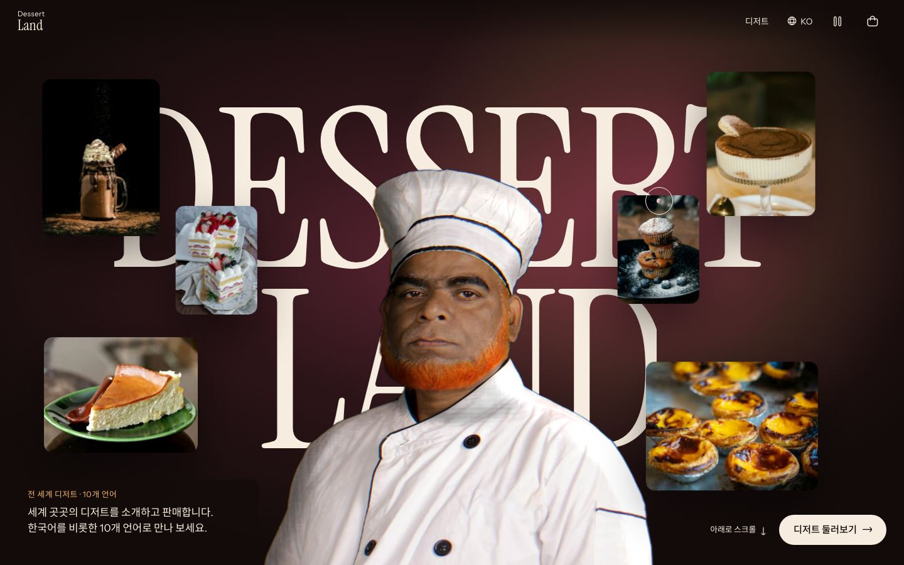
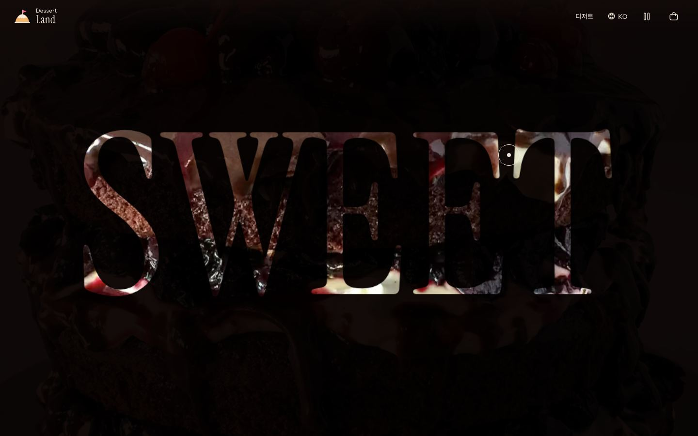
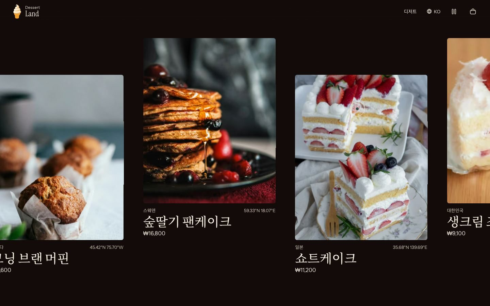
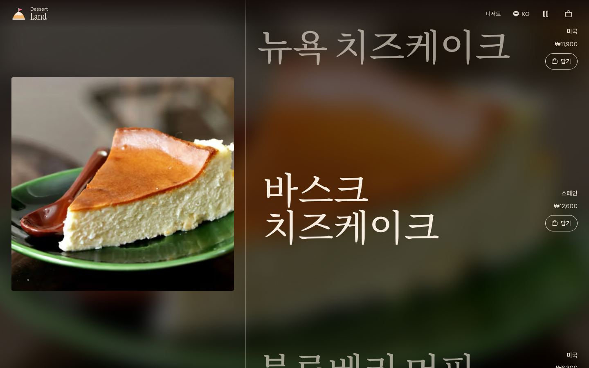
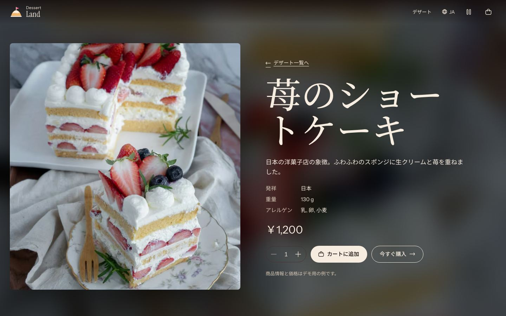
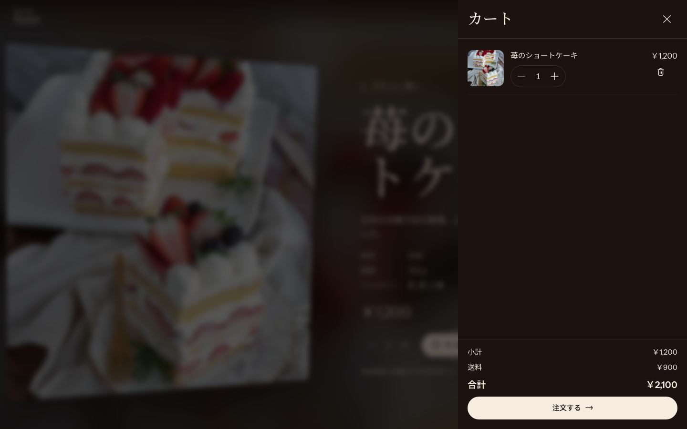
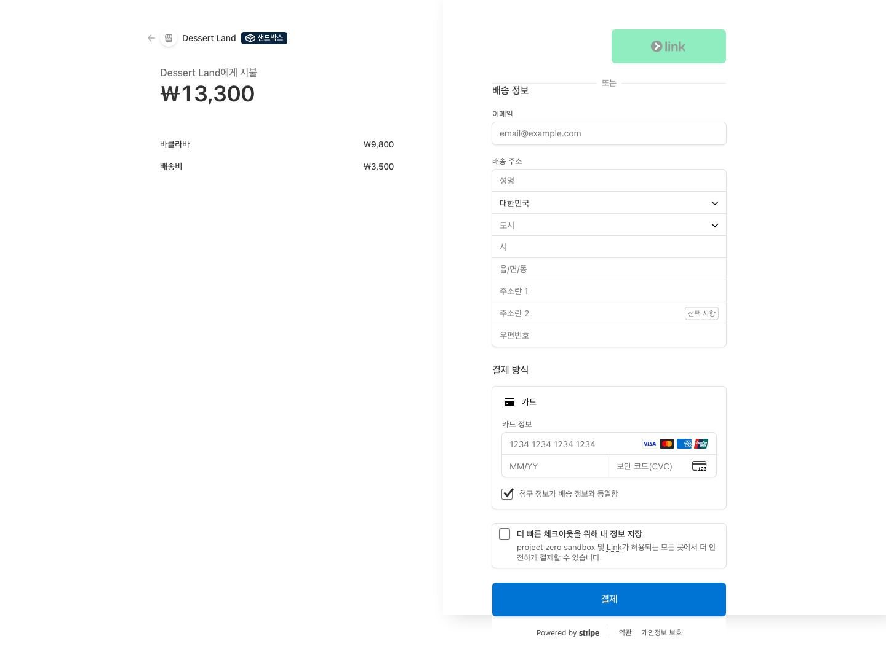
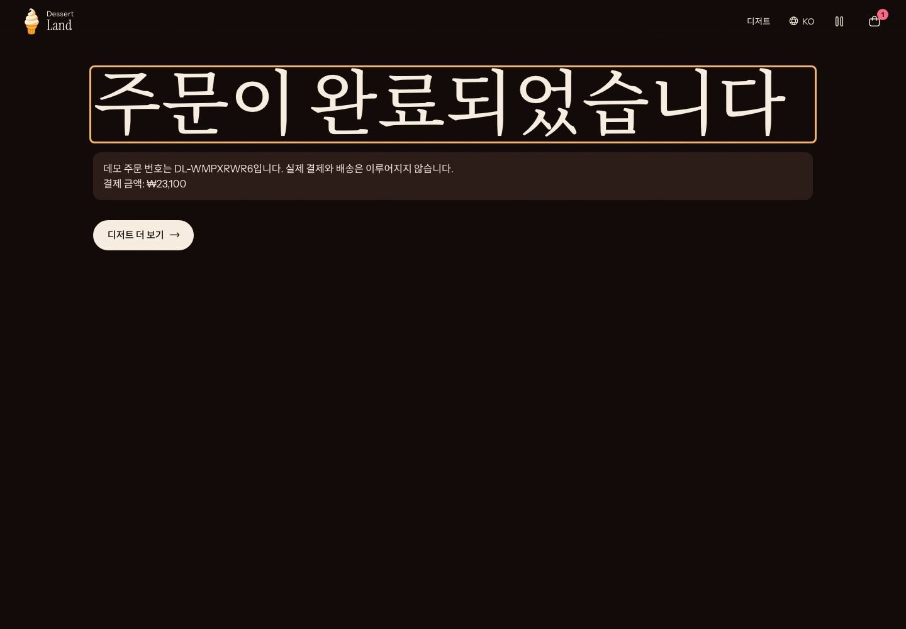

#  디저트 랜드 (Dessert Land)

[](https://github.com/ryushin01/DessertLand/actions/workflows/ci.yml)


디저트 랜드는 **전 세계의 디저트**가 모인 달콤한 나라를 콘셉트로, 디저트를 소개하고 판매하는 글로벌 쇼핑몰입니다. 한국어를 기본으로 **영어, 일본어, 중국어, 프랑스어, 이탈리아어, 스페인어, 독일어, 포르투갈어, 튀르키예어까지 10개 언어**를 지원합니다.

**[데모 바로 보기](https://dessert-land-ryushin01.vercel.app)** · **[디자인 시스템(Storybook)](https://dessert-land-ryushin01.vercel.app/storybook/index.html)** · 결제는 테스트 카드 `4242 4242 4242 4242`, 미래의 만료일, 아무 CVC로 해 볼 수 있고 실제 청구는 없습니다.

> **프로젝트 상태:** 별도 백엔드 없이 동작하는 **데모 프로젝트**입니다. 상품 정보와 가격은 예시 값이고, 환율은 고정값이며, 결제는 **실제 청구가 없는 테스트 결제**이며 배송도 이루어지지 않습니다. Stripe 테스트 키가 있으면 Stripe 화면에서 카드 정보를 입력하고, 없으면 카드 정보를 받지 않는 내장 테스트 결제창을 씁니다. 운영 키는 코드에서 거부합니다.

## 화면

사진은 [Unsplash](https://unsplash.com), 아이콘은 [Flaticon UIcons](https://www.flaticon.com/uicons)에서 가져왔습니다. 출처는 사이트의 출처 페이지에 있습니다.

| 첫 화면 | 카테고리 쇼케이스 |
|---|---|
|  |  |

| 글자 마스크 줌 | 세계 디저트 여행 |
|---|---|
|  |  |

| 상품 목록 | 상품 상세(일본어) |
|---|---|
|  |  |

| 장바구니(일본어) | Stripe 테스트 결제 |
|---|---|
|  |  |

| 주문 완료 | 모바일 |
|---|---|
|  |  |

## 주요 기능

| 구분 | 내용 |
|---|---|
| 전 세계 디저트 | 밀크셰이크, 치즈케이크, 머핀, 팬케이크, 생크림 케이크, 세계의 명작 등 13개 나라의 16종 |
| 10개 언어 | ko(기본), en, ja, zh, fr, it, es, de, pt, tr. 언어별 URL, 통화, 국가 이름, 숫자 표시. 언어 메뉴는 원형 국기와 나라 이름으로 고름 |
| 쇼핑 | 카테고리 필터, 상품 상세, 장바구니(저장 유지) |
| AI 추천 | 입맛을 적으면 Claude가 카탈로그 안에서 디저트를 추천(스트리밍). 키가 없으면 규칙 기반 추천 |
| 구매 | 장바구니에서 고른 상품만 주문(산 상품만 장바구니에서 뺌), 상세와 상품 목록의 바로 구매(장바구니 유지), 배송 정보 입력과 오류 안내 |
| 결제 | Stripe Checkout 테스트 모드(키가 없으면 내장 테스트 결제창), 서버 금액 검증, 중복 결제 방지 |
| 첫 화면 인터랙션 | 마우스 위치에 따라 가운데 손과 밀가루가 움직이고 빛이 바뀌는 WebGL 2.5D 시차 |
| 커서 | 따라오는 링, 흩날리는 스프링클, 끌어당기는 버튼, 지나간 자리에 피어나는 사진 |
| 스크롤 | 원형으로 열리는 장면 전환, 글자 마스크 줌, 가로 스크롤 여행, 단어별 밝아짐, 패럴랙스 |
| 보안 | 콘텐츠 보안 정책(CSP), 프레임 삽입 금지, 서버 금액 검증. 주요 화면의 CSP 위반을 E2E로 검사 |
| 성능 | Web Vitals 수집, 페이지별 전송량 예산(E2E), 언어별 글꼴과 필요한 코드만 로드 |
| 접근성 | 모션 멈춤 버튼, `prefers-reduced-motion` 대응, 키보드 초점 시 장면 이동, 본문 바로가기 |

## 기술 스택


| 구분 | 사용 기술 |
|---|---|
| 프레임워크 | Next.js 16 (App Router), React 19, TypeScript |
| 스타일 | Panda CSS |
| 상태 | jotai |
| 다국어 | next-intl, country-flag-icons(언어 메뉴 국기) |
| 결제 | Stripe Checkout(테스트 모드) |
| AI | Claude API (`@anthropic-ai/sdk`) |
| 모션 | GSAP(ScrollTrigger), Lenis, OGL(WebGL) |
| 품질 | ESLint(jsx-a11y), Vitest, Testing Library, Storybook 10, Playwright, axe, size-limit, Lighthouse CI |
| 모니터링 | Sentry(DSN이 있을 때만), web-vitals, Vercel Speed Insights |
| 구조 | Feature-Sliced Design |

## 시작하기

Node.js 22(`.nvmrc`)와 pnpm이 필요합니다.

```bash
corepack enable pnpm
pnpm install
pnpm dev    # http://localhost:3000
```

Stripe 테스트 결제와 AI 추천을 쓰려면 `.env.example`을 `.env.local`로 복사해 키를 넣습니다.

| 명령 | 설명 |
|---|---|
| `pnpm build` / `pnpm start` | 프로덕션 빌드와 실행 |
| `pnpm typecheck` / `pnpm lint` | 타입 검사와 린트 |
| `pnpm test` | 단위 테스트 |
| `pnpm e2e` | 프로덕션 빌드 기준 E2E와 접근성 검사(`pnpm build` 후 실행) |
| `pnpm size` / `pnpm lhci` | 번들 크기 예산 / Lighthouse 점수 기준 검사(`pnpm build` 후 실행) |
| `pnpm analyze` | 번들 분석 화면 |
| `pnpm storybook` | 컴포넌트 문서 |

## 프로젝트 구조

```
src/
├─ app/[locale]/   # 라우트. _pages를 다시 내보냅니다.
├─ proxy.ts        # 언어 라우팅
├─ _app/           # 레이아웃, 프로바이더, 전역 스타일
├─ _pages/         # 홈, 목록, 상세, 주문, 출처
├─ widgets/        # 히어로, 쇼케이스, 커서, 장바구니 등
├─ features/       # 담기, 바로 구매, 결제, 주문 폼, AI 추천, 언어 변경, 모션 멈춤
├─ entities/       # 상품 카탈로그, 장바구니
└─ shared/         # 다국어, 모션, UI
```

## 문서

| 문서 | 내용 |
|---|---|
| [개발 가이드](docs/development.md) | 언어와 상품 추가, 모션 규칙, 사진과 아이콘 라이선스 |
| [시퀀스 다이어그램](docs/sequence-diagrams.md) | Stripe 테스트 결제, 내장 테스트 결제, AI 디저트 추천(스트리밍) |
| [변경 기록](CHANGELOG.md) | 버전별 변경 사항 |
